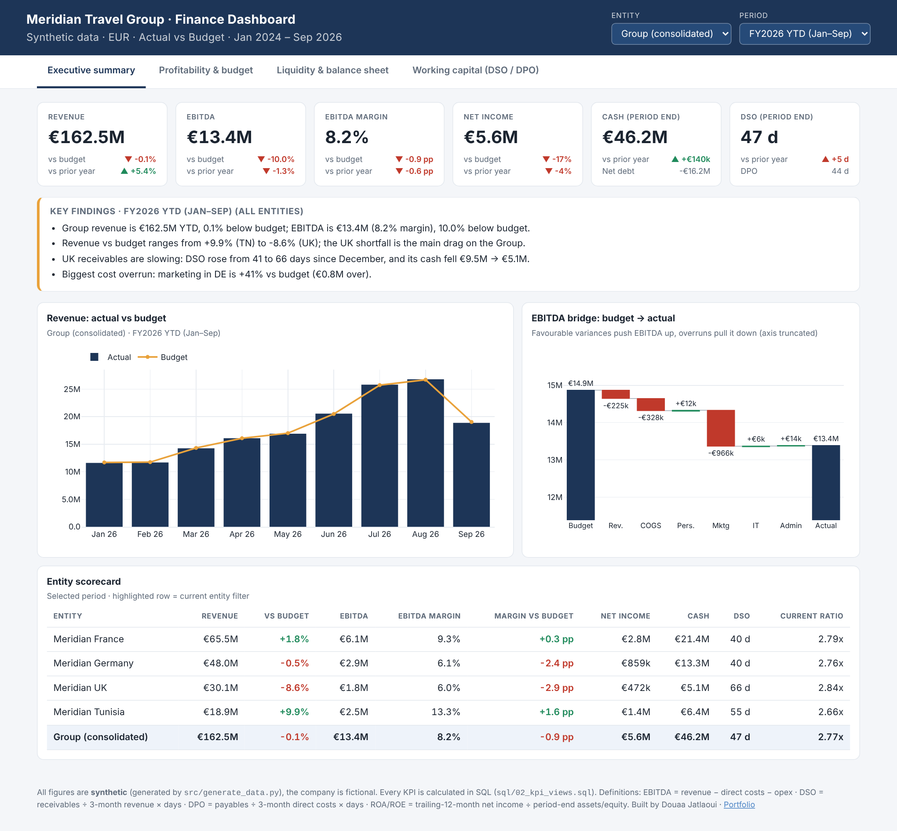

# Corporate Finance Dashboard: Budget vs Actual, Liquidity & Working Capital

An end-to-end Business Intelligence project for a fictional travel group (**Meridian Travel Group**, 4 entities, 33 months of data).
It mirrors what a finance BI analyst does in a treasury / controlling team: build a clean data model, calculate the KPIs in SQL, and turn them into a dashboard a CFO can use to ask *"where are we missing budget, and is cash at risk?"*

**▶ Live dashboard:** `https://<your-github-username>.github.io/<repo-name>/` *(enable GitHub Pages: Settings → Pages → Branch `main`, folder `/docs`)*



> All data is **synthetic** (generated by `src/generate_data.py`). The company is fictional; no real company data is used.

## Business questions answered

| Question | Where to look |
|---|---|
| Are we on budget for revenue, EBITDA and net income, and why not? | Executive summary: KPI cards, EBITDA bridge |
| Which entity is driving the variance? | Entity scorecard |
| Are margins and returns (ROA/ROE) improving? | Profitability tab |
| Can we cover our short-term obligations? Is net debt under control? | Liquidity tab |
| Are customers paying slower, and what does it do to cash? | Working capital tab (DSO / DPO / cash gap) |

## What the data says (FY2026 YTD, Jan–Sep)

These findings are generated automatically from the data by `src/build_dashboard.py`, so they never go stale:

- Group revenue is on budget (**−0.1%**) but **EBITDA is 10% below budget** (€13.4M, 8.2% margin).
- **UK** is the main drag: revenue **−8.6% vs budget**, and its **DSO rose from 41 to 66 days** since December, so cash fell from **€9.5M to €5.1M**. A collections problem, not just a sales problem.
- **Germany** marketing spend is **+41% over budget**, which explains its 2.4 pp EBITDA-margin gap.
- **Tunisia** beats budget (+9.9% revenue, 13.3% EBITDA margin); France is stable.

## Tech stack & skills shown

| Layer | Tools | What it demonstrates |
|---|---|---|
| Data generation | Python (pandas, numpy) | Realistic seasonality, budget vs actual logic, a balance sheet that balances by construction |
| Data model | SQL, star schema (SQLite; portable to PostgreSQL) | Fact/dimension modelling, keys and constraints |
| KPI layer | SQL views with window functions | Margins, budget variance, liquidity ratios, DSO/DPO, trailing-12-month ROA/ROE |
| Data quality | SQL checks run on every build | Balance sheet balances, no gaps, Group = sum of entities |
| Visualisation | Interactive HTML dashboard (plotly.js) | KPI design, variance analysis, EBITDA bridge, filters |
| Power BI | `powerbi/DAX_measures.md` | Full DAX measure set + model to rebuild the same report in Power BI |

## KPI definitions

| KPI | Formula |
|---|---|
| Gross margin | (Revenue − Direct costs) ÷ Revenue |
| EBITDA | Revenue − Direct costs − Opex |
| Net income | EBITDA − D&A − Interest − Tax |
| Budget variance | Actual − Budget (favourable = positive) |
| Current ratio / Quick ratio | Current assets ÷ Current liabilities / (Cash + Receivables) ÷ Current liabilities |
| Working capital | Current assets − Current liabilities |
| Net debt / EBITDA | (ST + LT debt − Cash) ÷ trailing-12-month EBITDA |
| DSO / DPO | Receivables ÷ 3-month revenue × days / Payables ÷ 3-month direct costs × days |
| ROA / ROE | Trailing-12-month net income ÷ period-end total assets / equity |

## Architecture

```
generate_data.py ──► data/raw/*.csv ──► SQLite star schema ──► SQL KPI views ──► docs/index.html
 (synthetic data)     (5 tables)        (sql/01_schema.sql)   (sql/02_kpi_views.sql)  (dashboard)
                                                     │                  └──► data/processed/kpi_monthly.csv (Power BI ready)
                                                     └── sql/03_checks.sql (data-quality gates)
```

```
├── run_pipeline.py           # one command rebuilds everything
├── src/
│   ├── generate_data.py      # synthetic data
│   ├── build_dashboard.py    # SQL views -> JSON -> HTML, plus auto-generated findings
│   └── dashboard_template.html
├── sql/                      # schema, KPI views, quality checks
├── data/raw/                 # star-schema CSVs
├── data/processed/           # KPI table for BI tools
├── powerbi/DAX_measures.md   # Power BI model + DAX
└── docs/                     # dashboard (GitHub Pages) + screenshots
```

## Run it locally

```bash
pip install -r requirements.txt
python run_pipeline.py          # rebuilds data, database, checks and dashboard
open docs/index.html            # or double-click it
```

## Design decisions worth knowing

- **Single source of truth:** every KPI is calculated once, in SQL. The dashboard and the Power BI file read the same logic.
- **3-month rolling DSO/DPO:** travel is highly seasonal, so point-in-time ratios would swing with the season rather than with collection performance.
- **FY2026 is year-to-date:** year-over-year comparisons use the *same months* of the prior year, so YTD is never compared with a full year.
- **Costs stored as positive numbers**, with the sign derived from the account category. This is common in management reporting and keeps the variance logic readable.

## Author

**Douaa Jatlaoui**: Business Intelligence & Data Analyst · [Portfolio](https://d00042.github.io/Portfolio) · [LinkedIn](https://linkedin.com/in/douaa-jatlaoui-030725327)
